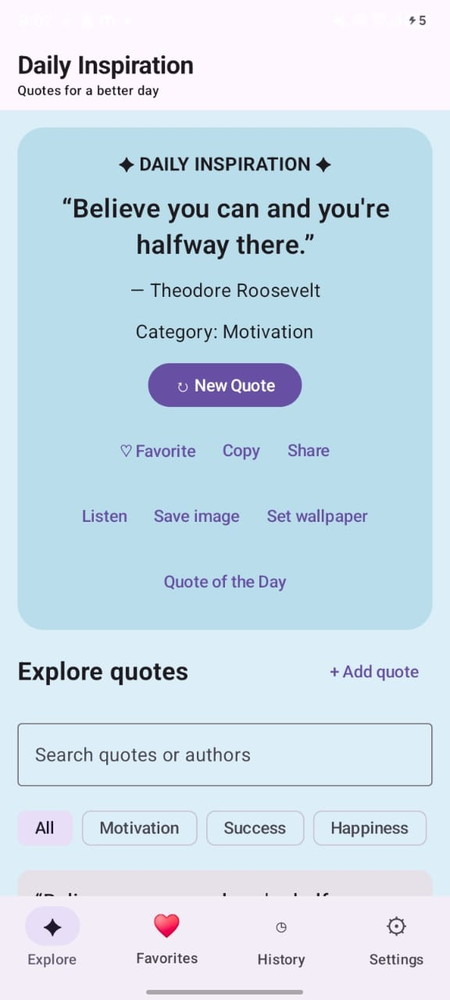

# 💬 Random Quote Generator

An Android application that displays inspiring and motivational quotes through a simple and interactive interface. Built using **Kotlin** and **Jetpack Compose** as part of the CodeAlpha App Development Internship.

## ✨ Features

- 💬 Display inspirational quotes
- 🔄 Generate a new quote with a button
- 🎨 Simple and user-friendly interface
- 📱 Android application design
- ⚡ Lightweight and easy to use
- 🌟 Discover motivational quotes whenever you need inspiration

## 🛠️ Technologies Used

- Kotlin
- Android Studio
- Jetpack Compose
- Gradle

## 📱 Application

The Random Quote Generator helps users discover motivational and inspirational quotes through a simple Android application.

Users can view a quote and generate another one using the **New Quote** button.

## 🚀 How to Run

1. Clone or download this repository.
2. Open the project in Android Studio.
3. Allow Gradle to sync and download the required dependencies.
4. Connect an Android device or start an Android Emulator.
5. Click the **Run ▶️** button.
6. The Random Quote Generator will launch on your device.

## 🎓 Internship

This project was developed as part of the **CodeAlpha App Development Internship – Task 2: Random Quote Generator**.

## 👩‍💻 Author

**Moulya R**

BCA Student

## 📸 Screenshot

